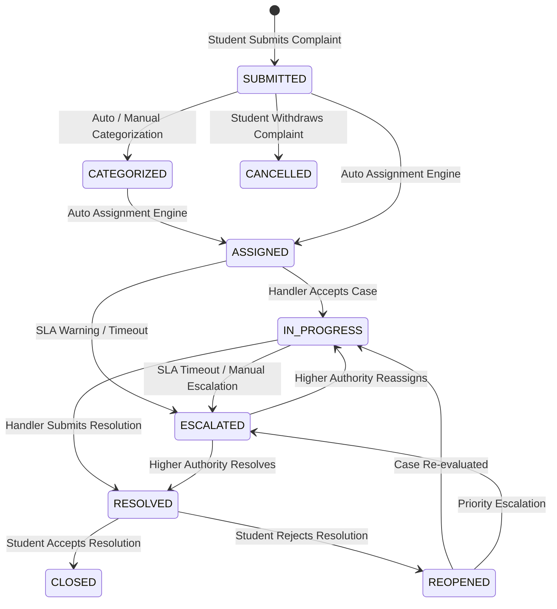

# 📘 Phase 3 – Complaint Lifecycle Engine Technical Design Document (TDD v3.0)

---

## 1. Executive Summary & Aggregate Pattern

The **Complaint Lifecycle Engine** is the core case-management domain of CCMS. Rather than treating a complaint as a simple database record, it is designed as a domain-driven **Complaint Aggregate**:

```
                      ┌───────────────────────────────┐
                      │   Complaint Aggregate Root    │
                      └───────────────┬───────────────┘
                                      │
 ┌───────────────┬───────────────┼───────────────┬───────────────┬───────────────┐
 ▼               ▼               ▼               ▼               ▼               ▼
Timeline      Assignment      Comments      Attachments     SLA Timer     Workflow Instance
Ledger        Engine          Thread        Vault           Engine        State Machine
```

---

## 2. Formal State Machine Lifecycle



---

## 3. SLA Calculation & Timer Rules

1. **SLA Window Determination**:
   - `slaHours` is derived dynamically from `masterComplaintMetadata` based on `categoryCode` + `subcategoryCode` (e.g., Hostel Maintenance: 24h, Wi-Fi: 12h, Academic Grading: 48h).
2. **SLA Deadline Calculation**:
   - `slaDeadline = createdAt + (slaHours * 3600 * 1000)`.
3. **Automated Escalation Triggers**:
   - Background scheduler checks active complaints where `now > slaDeadline` and status is not `RESOLVED` or `CLOSED`.
   - Automatically transitions status to `ESCALATED`, reassigns to `escalationRoleCode` (e.g. `HOD` / `DEAN`), appends timeline entry, and emits `ComplaintEscalated` event.

---

## 4. Automated Assignment Strategy (Zero Hardcoded Logic)

The assignment engine operates dynamically through `ReferenceDataService` and `RelationshipService`:

```
Category / Subcategory Lookup
             │
             ▼
    Target Department Code
             │
             ▼
RelationshipService.getRelationshipTarget('DEPARTMENT', deptCode, 'HAS_HOD')
             │
             ▼
     Faculty User UUID (Assigned Handler)
```

---

## 5. Immutable Timeline Ledger Model

Every action appends an immutable timeline entry to the complaint aggregate:

```json
{
  "timelineUuid": "tl_901238491",
  "eventType": "COMPLAINT_ASSIGNED",
  "actorUuid": "9b1deb4d-3b7d-4bad-9bdd-2b0d7b3dcb6d",
  "actorName": "Auto Assignment Engine",
  "previousState": "SUBMITTED",
  "newState": "ASSIGNED",
  "assignedToUuid": "faculty_user_uuid_102",
  "assignedToName": "Dr. Suresh Kumar (HOD)",
  "note": "Automated assignment based on CSE Department HOD mapping.",
  "timestamp": "2026-08-03T19:10:00.000Z"
}
```

---

## 6. API Contracts

### 6.1 `POST /api/v1/complaints`
- **Request Body**:
```json
{
  "title": "Water Leakage in Hostel Room 302",
  "description": "Pipe leaking heavily under sink since morning.",
  "categoryCode": "HOSTEL",
  "subcategoryCode": "MAINTENANCE",
  "priority": "HIGH",
  "location": {
    "buildingCode": "HOSTEL-H3",
    "roomCode": "302"
  },
  "attachments": []
}
```
- **Success Response (201 Created)**:
```json
{
  "success": true,
  "message": "Complaint created and assigned successfully.",
  "data": {
    "complaintUuid": "cmp_801923841",
    "complaintCode": "CMP-2026-000104",
    "status": "ASSIGNED",
    "assignedTo": {
      "userUuid": "faculty_uuid_102",
      "name": "Dr. Suresh Kumar",
      "role": "HOD"
    },
    "slaDeadline": "2026-08-04T19:10:00.000Z"
  }
}
```

---

## 7. Power BI Analytics Ingestion

All complaint lifecycle events emit analytics events into `reportingComplaintFact` and `reportingSlaFact`:

- `ComplaintCreated` -> `reportingComplaintFact` (Increments open complaints count).
- `ComplaintEscalated` -> `reportingSlaFact` (Logs SLA breach fact).
- `ComplaintResolved` -> `reportingComplaintFact` (Calculates resolution duration).
